# 钛斜槽计算图集

本图集汇总 6 张当前结果与诊断图，以及 10 张既有历史图。当前结构结果只覆盖同一稳定 Ti 模型下的二维斜槽、p 偏振、离散波长与 ±30° 两角；历史图的旧模型或旧合格状态不继承到当前研究。

[返回结果总览](README.md) · [结构数值数据](data/current_structured_results.json) · [历史原图校验目录](data/existing_figure_catalog.json)

## 当前结果与诊断

### 图 1 占空比筛选

10.5 μm、p 偏振、r20、±30°。F 是空气开口宽度与周期之比。已采样的 F = 0.50、0.65、0.80 中，F = 0.65 的 +30° 吸收响应和两角差最大；A_flux 与 A_vol 均呈相同趋势。虚线只引导视线，三个点不能确定全局最优。右图是两角差，不是完整方向性因子。

[SVG](figures/current/01_fill_comparison.svg) · [配对数值](data/direction_pairs.json)

### 图 2 三个波长的离散响应

F = 0.65，p 偏振、r20，8、10.5、13 μm，±30°。图中只显示实际采样点，未连接成连续光谱。它支持比较这三个波长的两角响应，不能代替 8–13 μm 连续发射率谱或带内平均值。

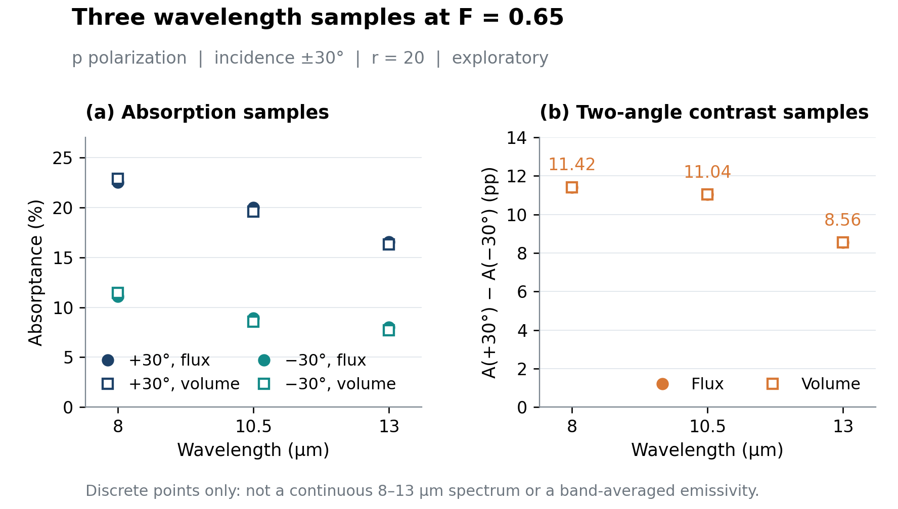

[SVG](figures/current/02_wavelength_samples.svg) · [结构数值](data/current_structured_results.json)

### 图 3 当前结构点的数值残差

10 个当前结构点的 A_flux − A_vol 与原始有符号净透射 T。吸收差约为 0.27–0.38 个百分点，符号随波长变化。差值是独立算法之间的诊断量，不是总误差界；负透射保留用于排查，不能解释为材料增益。

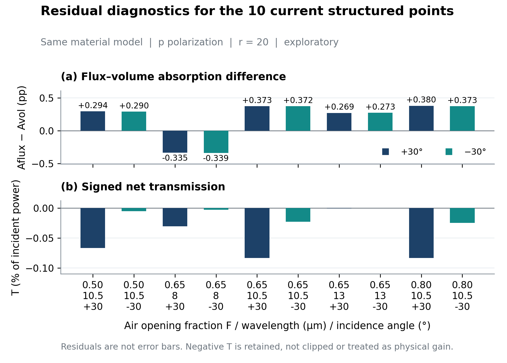

[SVG](figures/current/03_numerical_residuals.svg) · [结构数值](data/current_structured_results.json)

### 图 4 正入射平面的源口径控制

10.5 μm、正入射、r20。采用同一种电源或磁源口径时，平面 s/p 结果在数值精度内一致；电源与磁源的 A_flux 差约 0.371 个百分点，A_vol 则接近。该图不是斜槽的物理偏振对比，也不能导出全部结构的统一修正系数。

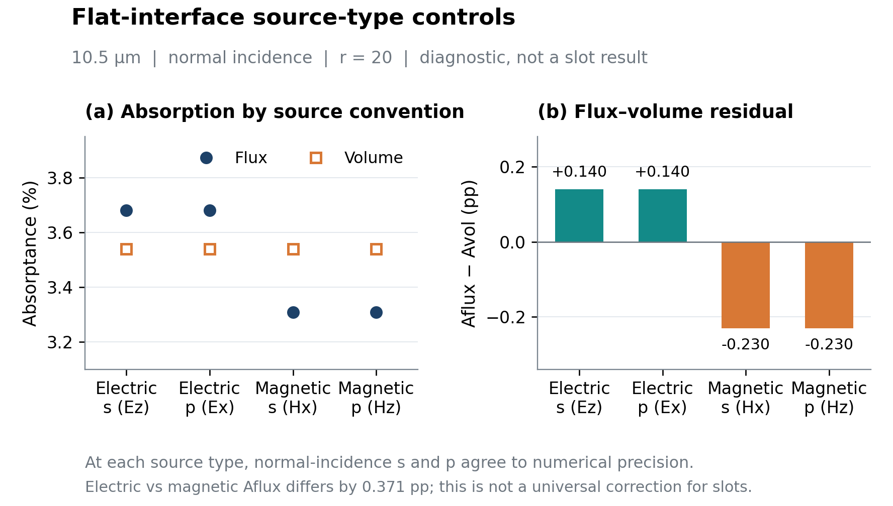

[SVG](figures/current/04_source_type_diagnostic.svg) · [源口径诊断数据](data/source_type_diagnostic.json)

### 图 5 当前二维周期斜槽几何

周期 50 μm、槽轴长 40 μm、倾角 30°、Ti 厚度 60 μm；F = 0.50、0.65、0.80 对应开口宽度 25、32.5、40 μm。白色为空气槽，填色为 Ti，左右显示相邻周期延拓。F 改变时最大深度和剩余底厚同步改变，因此不能将该比较称为固定深度的孔径效应。

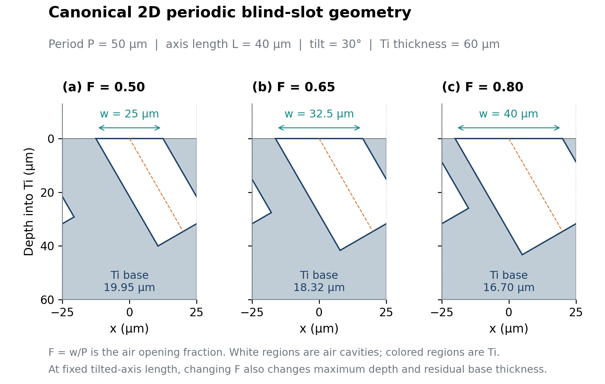

[SVG](figures/current/05_geometry.svg) · [几何和设置](data/geometry_and_settings.json)

### 图 6 同材料平面 Fresnel 检查

左图为 p 偏振、r20、±30° 的离散波长控制；右图为 s 偏振、r28、10.5 μm、+30° 的两档源频宽控制。12 项中 4 项通过对应严格平面门槛，8 项保留为精度未通过诊断。0.25 个百分点虚线是当次平面反射率检查门槛，不是当前所有结构点的通用误差条。

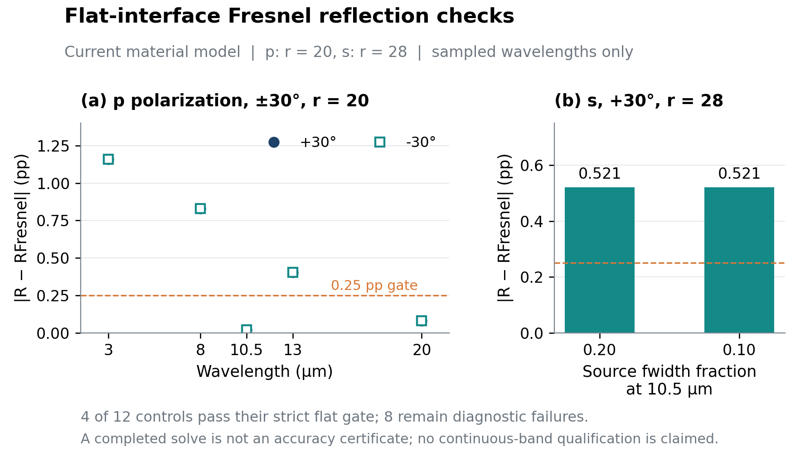

[SVG](figures/current/06_flat_validation.svg) · [平面控制数据](data/flat_validation_results.json)

## 历史诊断与几何图

以下原图保持原样，供理解数值问题的排查路径。它们不是当前稳定材料的参数扫描结果。原图中的 `QUALIFIED` 只表示历史记录当时的局部状态，不是当前整体研究通过。

### H01 平面空间离散诊断

2026 年 9 月 22 日，旧 Ti 模型，平面 p 偏振 +30°。左图 r20/r24/r32 是独立离散方程预测，不是已完成 FDTD；r16 预测与保存 Meep 反射率相差约 1.45×10⁻⁶。该证据定位旧算例的趋肤区空间离散误差，不能认证当前斜槽网格或充当统一修正量。

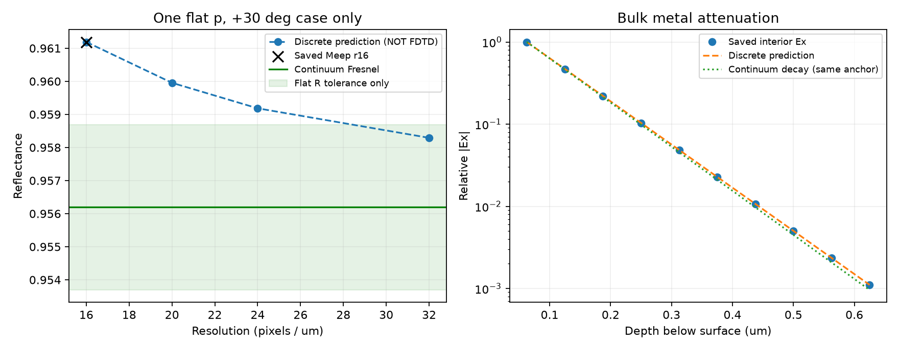

### H02 均匀平面边界筛选

2026 年 9 月 24 日，数值宽度 2 μm，旧模型。背景反射与前向功率比由 1.7167×10⁻³ 降至 2.2635×10⁻⁴；三项完整算例仍记录 `NUMERICAL_FAILED`。低于某条虚线只代表一项指标改善，不表示整体合格，也不代表 50 μm 斜槽发射率。

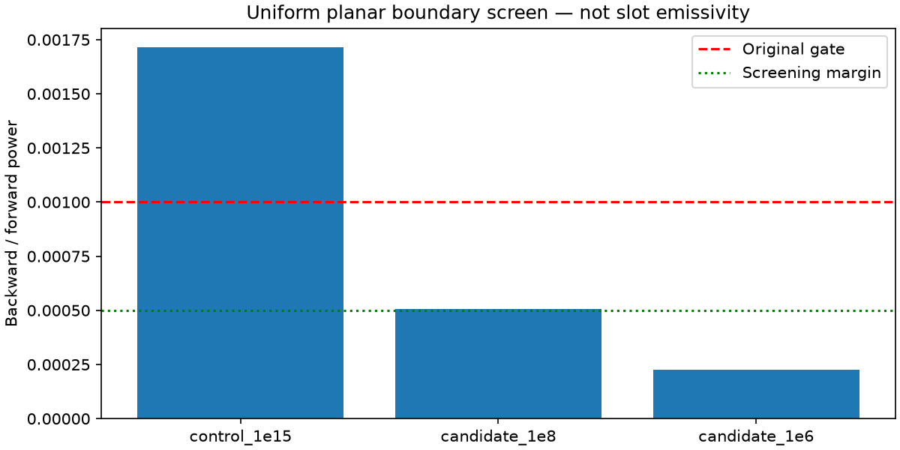

### H03 r24 停止与反射率尾部

2026 年 9 月 30 日，旧模型、旧停止分母口径。r24 尾场末值约 1.942×10⁻⁴，未达到当时 10⁻⁴ 的停止线，尽管 R/T 尾部漂移已较小。尾场拟合不能替代停止证据，也不能恢复完整时间步状态。

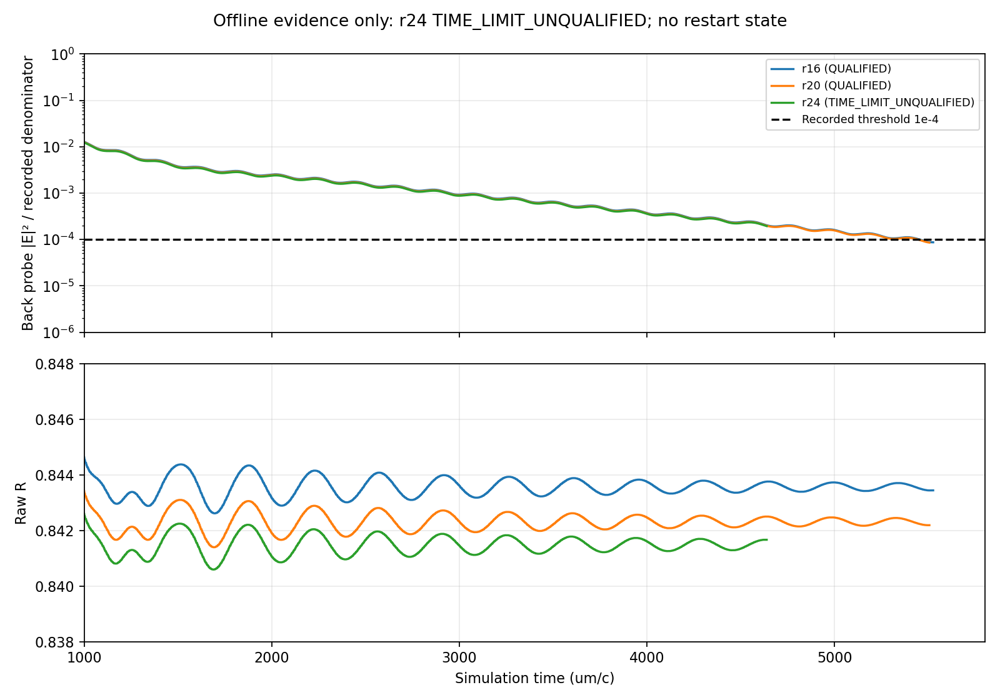

### H04 早期单点及独立吸收诊断

2026 年 9 月 21 日，10.5 μm、+30°、p 偏振。原结果停止资格未证实；右图绿色值为离线吸收积分诊断，不是重算后的生产结果。该图的材料、实现与验收状态不同，不能并入当前占空比曲线。

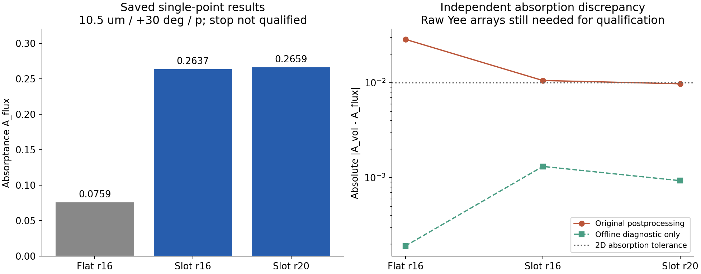

### H05 尾场频谱比较

历史 PML6 与 PML12 诊断使用规则采样场数据离线恢复 FFT，无插值或重采样。横轴为带符号频率，纵轴为相对 Ex/Ey 频谱强度；这不是热发射率光谱。原始条件未取得光学资格。

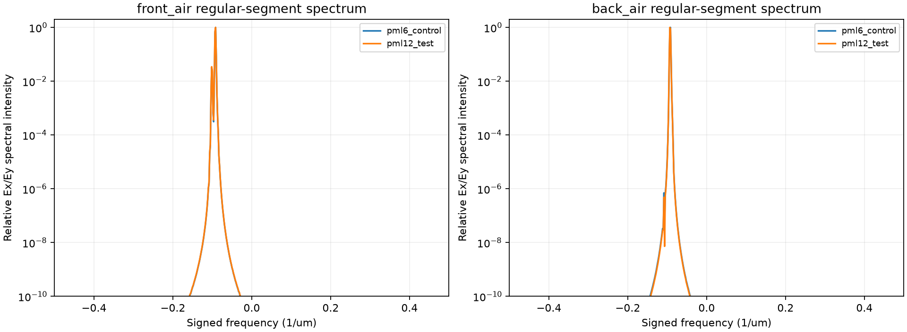

### H06 PML 厚度与背面尾场

匹配区间 t = 1000–1200 内，历史 PML12 背面平均归一化强度约为 PML6 的 0.620 倍，二者仍远高于停止线。它表明尾场对边界厚度敏感，不能单独证明边界是全部偏差的原因。

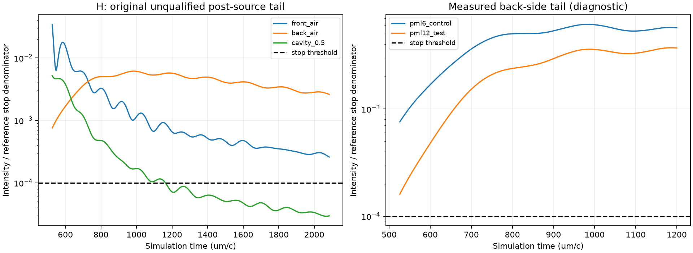

### H07 旧 Route A 材料拟合

旧 Ti 模型的 6–16 μm 拟合，不是 2026 年 10 月 11 日后使用的稳定宽带模型。圆点为 Ordal 表格节点，插值目标不是新增测量；拟合误差不代表实际加工 TA2 样品或高温材料误差。16 份相同旧资产在此仅保留一份。

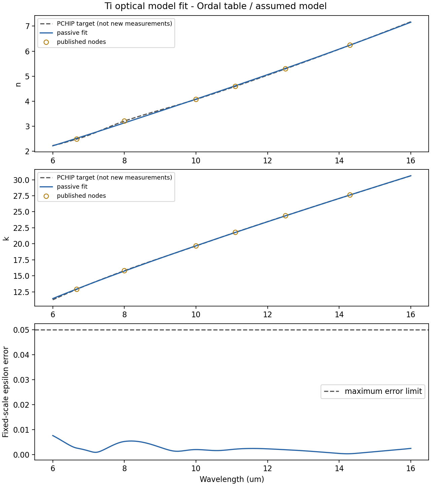

### H08 金属内部场衰减

历史平面 Ti、8.5 μm、r32。近表面场衰减接近锚定的解析曲线，但深部场重新增大，原报告保留边界或激励污染待查。因此不能仅凭近表面拟合推断整个内部场可信，也不能把它当作当前斜槽吸收空间分布。

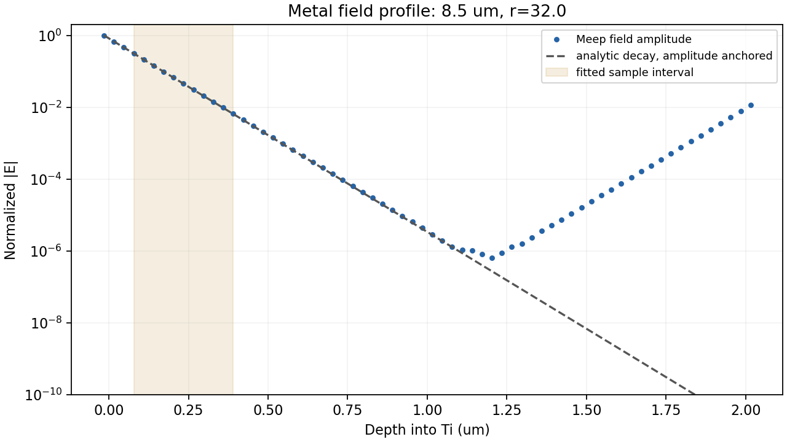

### H09 历史平面网格诊断

早期平面 Ti 的反射率与 Fresnel 差、独立体吸收差随网格分辨率的变化。误差按入射功率归一化。最细网格的平面单点不能自动认证当前稳定材料的斜槽模型。

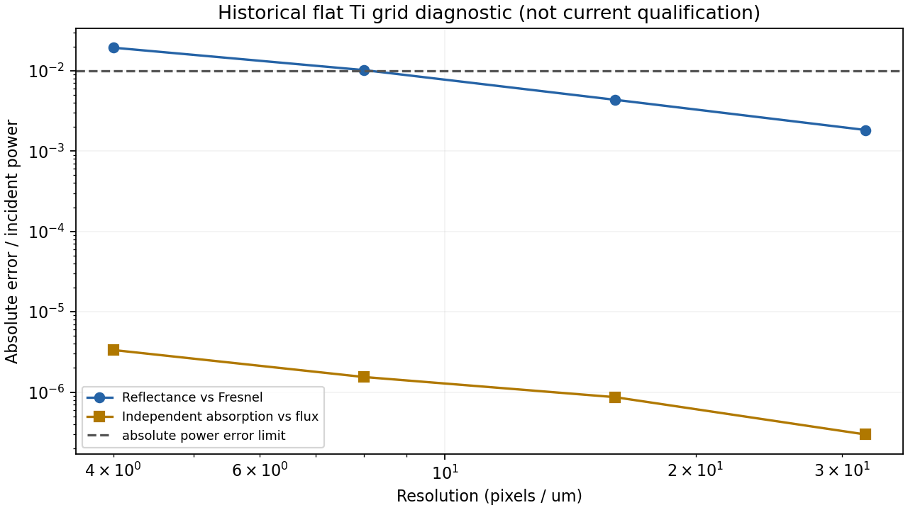

### H10 三维盲孔几何截面

历史三维假设几何的实体检查，不是三维电磁计算。原假设为周期 50×50 μm、孔径 30 μm、轴长 40 μm、倾角 30°、Ti 厚度 60 μm；其三维圆孔不同于当前二维无限延伸斜槽，不能直接套用当前二维吸收率。

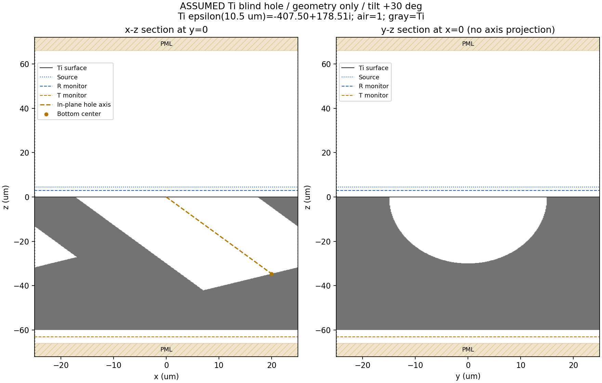

## 图集边界

源文件标识及原图 SHA256 见 [历史图目录](data/existing_figure_catalog.json)。软件合成示例的 Pareto、角谱和 FWHM，未通过资格时的空白占位图，理想目标光谱、制造界面、费用图及历史报告页面预览均未作为物理结果收录。
