# 图表汇总

每张图的模型、范围和限制以合并报告及数据文件为准，不跨模型拼接为同一性能曲线。

## 图 1：研究路径与证据层级

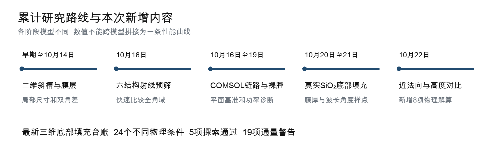

## 图 2：二维 Meep 占空比和选定波长

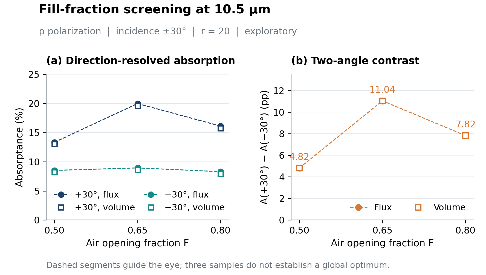

## 图 3：历史膜层代理结果

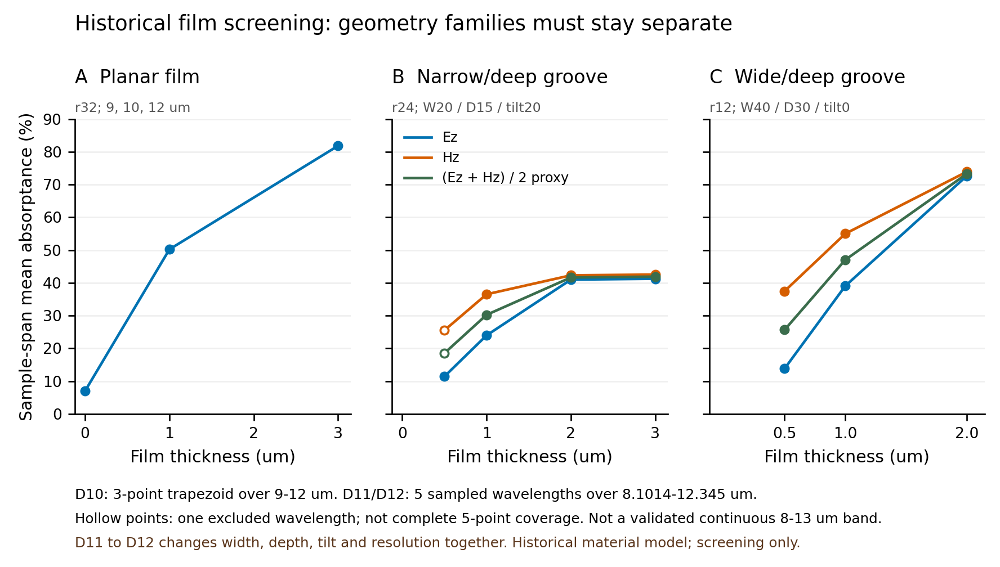

## 图 4：六种射线筛选结构

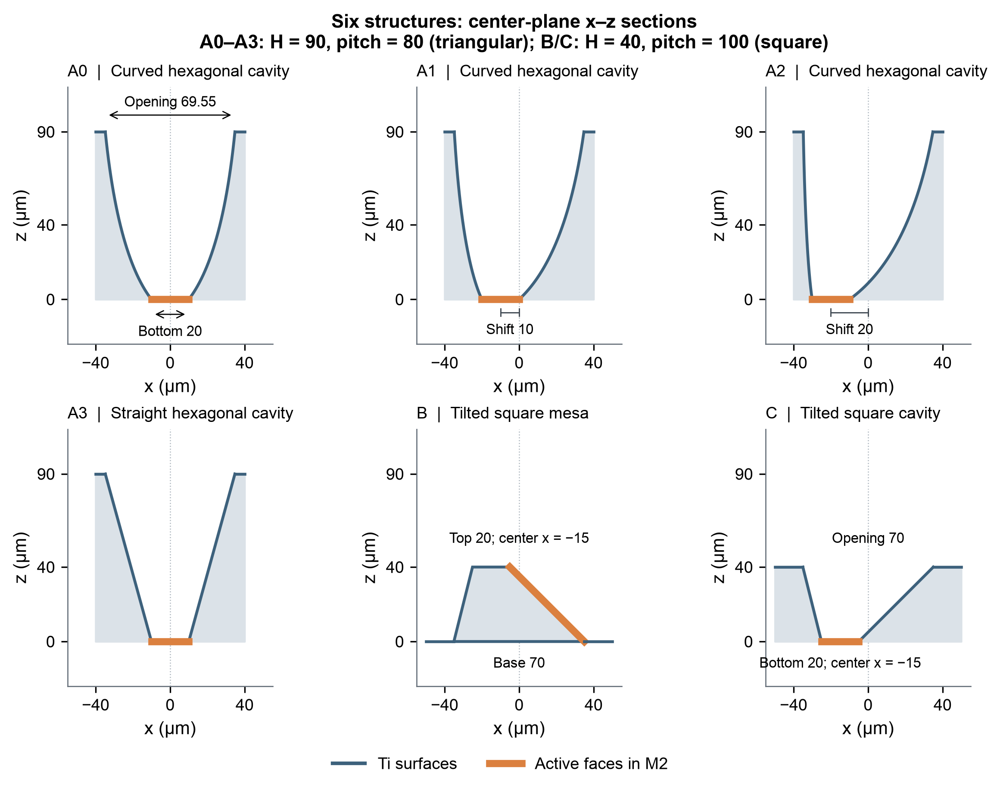

## 图 5：角锥功率与集中度权衡

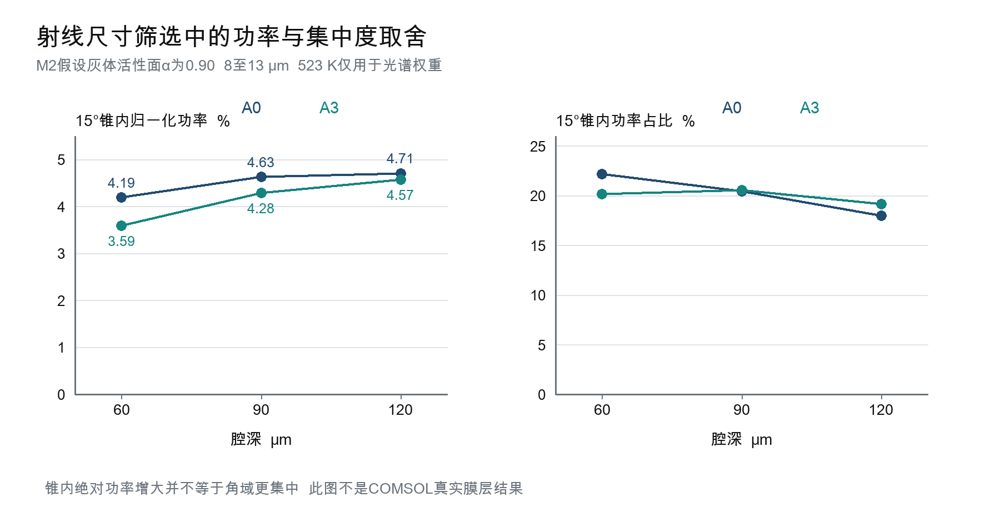

## 图 6：当前三维腔体和底部填充

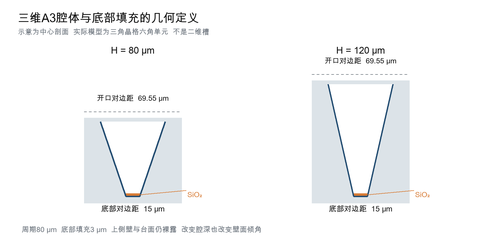

## 图 7：底部填充厚度对比

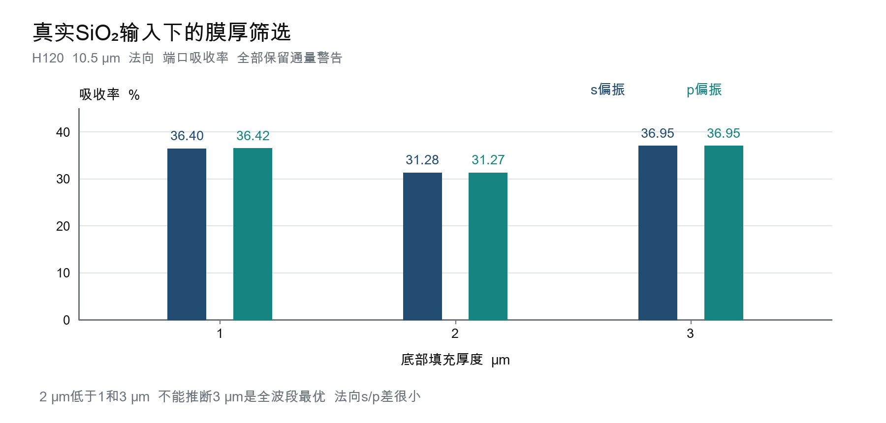

## 图 8：稀疏角度截面对比

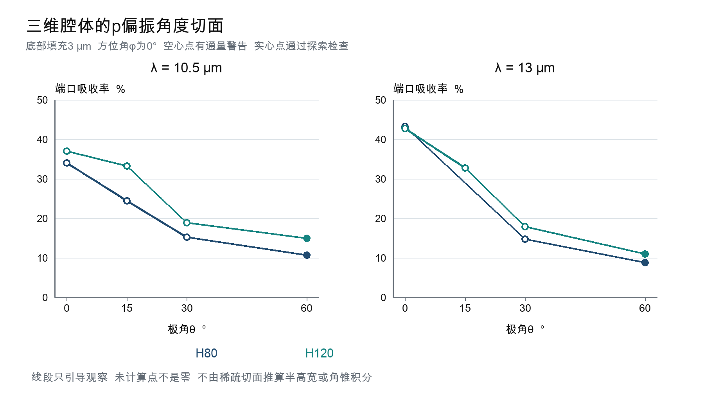

## 图 9：高度与偏振对比

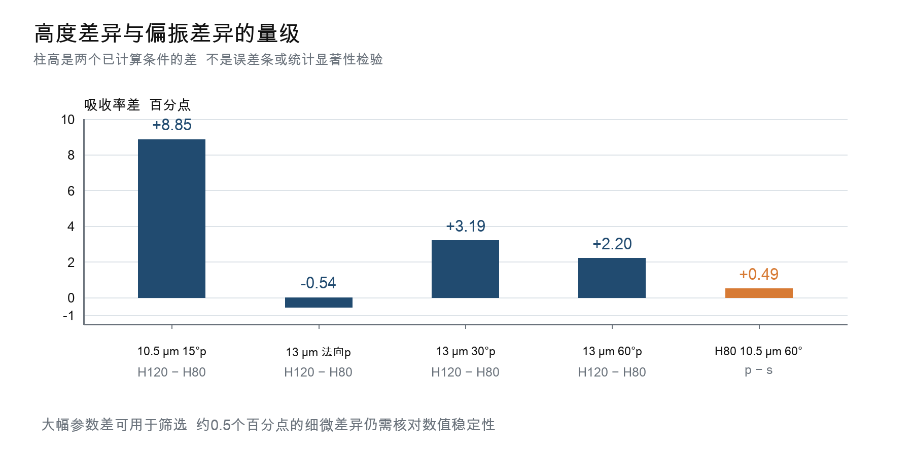

## 图 10：吸收分项

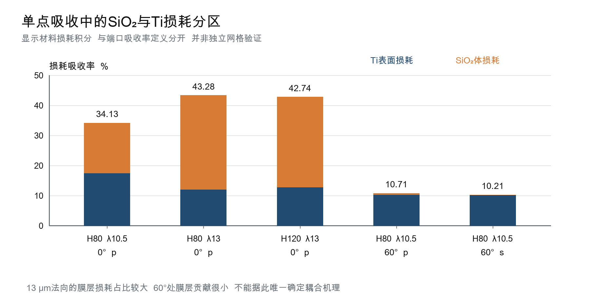

## 图 11：独立功率偏差

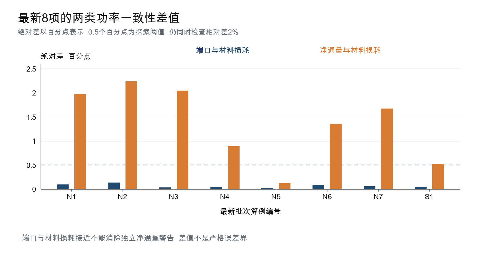

## 图 12：保存场截面诊断

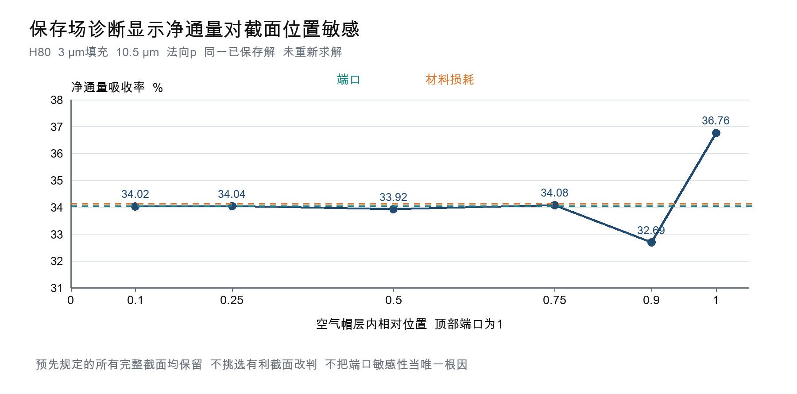
